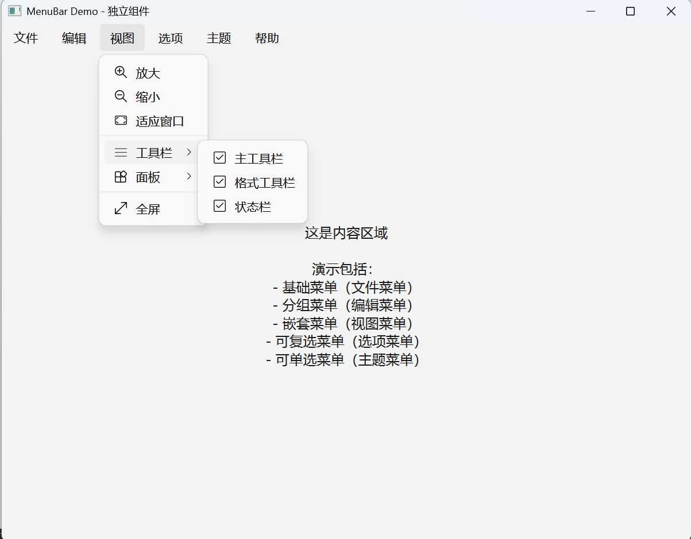
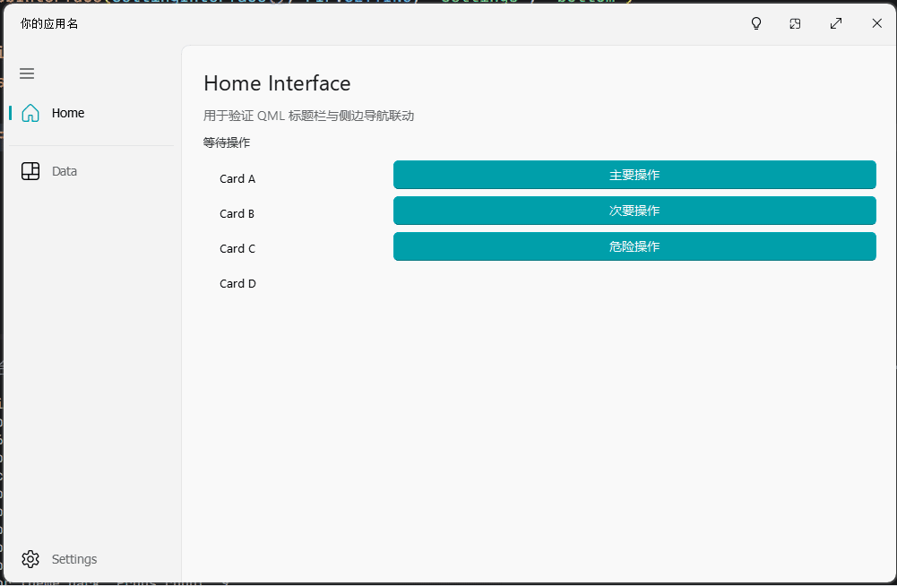

# PySide6-Fluent-Widgets

A secondary development of the **PySide6** branch of [PyQt-Fluent-Widgets](https://github.com/zhiyiYo/PyQt-Fluent-Widgets), for building Fluent Design desktop UIs quickly.

> [!IMPORTANT]
> **This project has moved to GitHub. The Gitee mirror is no longer maintained.**  
> Active branch: https://github.com/liberalchang/PyQt-Fluent-Widgets/tree/PySide6  
> Legacy Gitee archive: https://gitee.com/liberalchang/pyside6-fluent-widgets

[简体中文](README.md) | [English](README.en.md)

## Features

- Extended from the official PySide6 branch (`1.11.3-liber.1`)
- **Vispy**: 2D/3D plotting, camera & coordinates, Mica / maximized window support
- **ECharts**: dynamic charts, time series, combined charts, and View APIs
- **QML Hybrid**: splash / quick windows and a QML FluentWindow
- Extra widgets: sortable table, command bar, tool panel, splitter, color pickers, top navigation, and more

## Install

Lite:

```shell
pip install PySide6-Fluent-Widgets -i https://pypi.org/simple/
```

Full (vispy / numpy / PyOpenGL, etc.):

```shell
pip install "PySide6-Fluent-Widgets[full]" -i https://pypi.org/simple/
```

> [!WARNING]
> Do not install PyQt-Fluent-Widgets, PyQt6-Fluent-Widgets, PySide2-Fluent-Widgets, and PySide6-Fluent-Widgets together — they share the package name `qfluentwidgets`.

## Local development

Use a project-root `.venv` (conda is not used):

```shell
python -m venv .venv
.venv\Scripts\activate
pip install -U pip
pip install -r requirements.txt
pip install -e .
```

## Examples

Official gallery:

```shell
.venv\Scripts\activate
cd examples/gallery
python demo.py
```

Secondary-development demos live under `tests/`. See [`tests/TESTS_SUMMARY.md`](tests/TESTS_SUMMARY.md).

## Documentation

```shell
.venv\Scripts\activate
pip install sphinx sphinx-rtd-theme sphinx-markdown-tables recommonmark
build_docs.bat
# or: python build_docs.py
```

More notes: [`docs/README.md`](docs/README.md). Upstream docs: [qfluentwidgets.com](https://qfluentwidgets.com/).

## Preview

| Module | Preview |
| --- | --- |
| Vispy 2D / 3D |   |
| Vispy interactive |  |
| ECharts |   |
| Sortable table |  |
| Acrylic / top nav |   |
| Command bar |   |
| Menu / splitter / tool panel |    |
| Inputs & color |    |
| QML splash / FluentWindow |   |

## Issue reporting

For bugs in this fork, email [changxianglong@outlook.com](mailto:changxianglong@outlook.com) with:

- OS information
- Library version (e.g. `1.11.3-liber.1`)
- Minimal reproducible code
- Steps to reproduce

Or open a GitHub issue: https://github.com/liberalchang/PyQt-Fluent-Widgets/issues

## Repositories

| Role | URL |
| --- | --- |
| This project (maintained) | https://github.com/liberalchang/PyQt-Fluent-Widgets/tree/PySide6 |
| Upstream | https://github.com/zhiyiYo/PyQt-Fluent-Widgets/tree/PySide6 |
| Gitee archive (read-only) | https://gitee.com/liberalchang/pyside6-fluent-widgets |

## License

Non-commercial use under [GPLv3](LICENSE). For commercial licensing, see upstream [QFluentWidgets](https://qfluentwidgets.com/price). Upstream copyright belongs to zhiyiYo; secondary development in this repo is maintained by liber.
