# PySide6-Fluent-Widgets

A secondary development version based on the PySide6 branch of PyQt-Fluent-Widgets, adding multiple engineering components and display capabilities for quickly building Fluent Design style desktop applications.

## Features Overview
- Extended from the official PyQt-Fluent-Widgets PySide6 branch
- New vispy module for plotting
- New echarts module for chart display
- New qml implementation for startup and quick windows (FluentWindow QML implementation)

## Install
Lite version:
```shell
pip install PySide6-Fluent-Widgets -i https://pypi.org/simple/
```
Full version (including more optional capabilities):
```shell
pip install "PySide6-Fluent-Widgets[full]" -i https://pypi.org/simple/
```

> [!Warning]
> Do not install PyQt-Fluent-Widgets, PyQt6-Fluent-Widgets, PySide2-Fluent-Widgets, and PySide6-Fluent-Widgets at the same time because they share the same package name `qfluentwidgets`.

## Documentation
Building documentation requires `sphinx` and `sphinx-rtd-theme` packages:
```shell
pip install sphinx sphinx-rtd-theme
```
Build documentation:
```python
python build_docs.py
```

## Run Official Example
```shell
cd examples/gallery
python demo.py
```

## Notes
This project extends the following capabilities based on the official PySide6 branch:
- vispy drawing module
- echarts chart module
- qml startup window and quick window (FluentWindow QML implementation)

## New Components Details
- **Vispy Drawing**: Supports 2D/3D scene rendering, camera control, coordinate transformation, compatible with Mica effects and maximized windows. Example: `tests/test_vispy_widget.py`
- **ECharts Charts**: Supports dynamic charts, real-time time-series data updates, and combined charts. Example: `tests/echarts_test.py`
- **QML Startup & Quick Windows**: Uses Qt Quick to implement startup windows and quick windows, providing a QML version of FluentWindow for rapid navigation window construction.

## Functional Test List (New Components)

- Check `test` for `TESTS_SUMMARY.md`

## Image Preview

### Vispy Drawing Scene
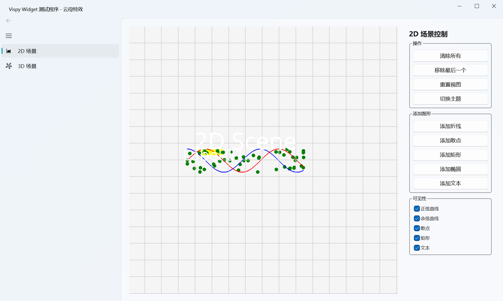
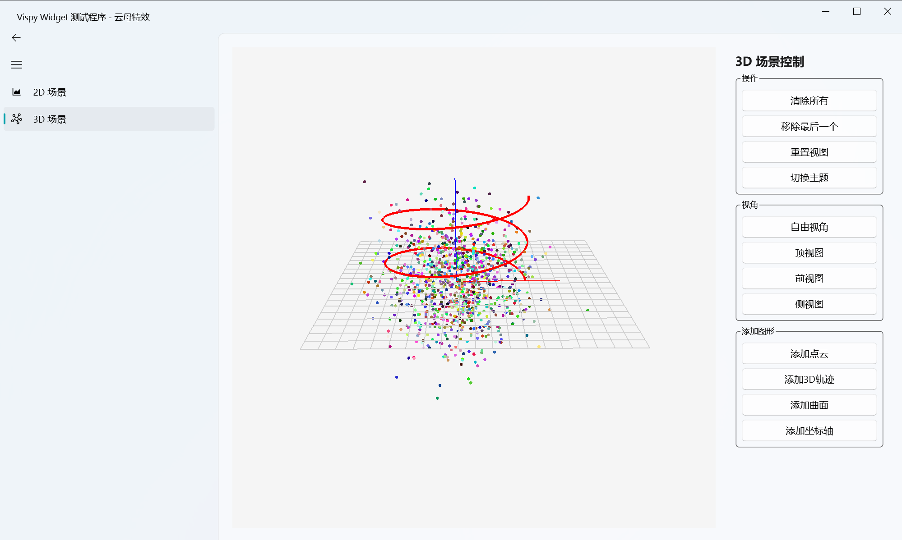

### Vispy Interactive Drawing Scene
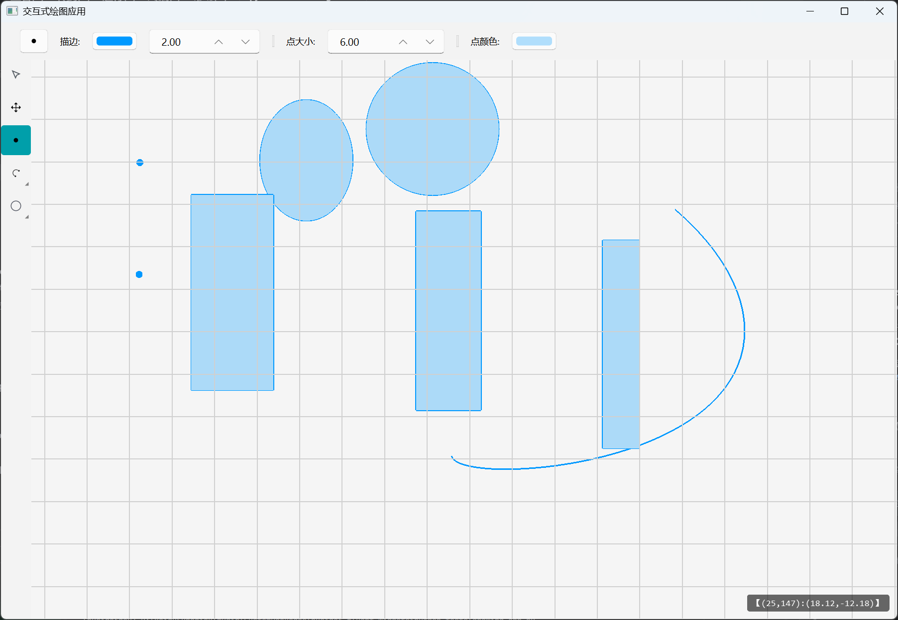

### ECharts Dynamic Update Example
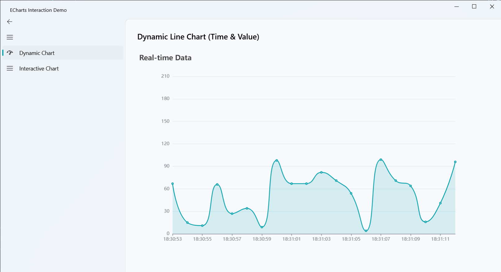
New view example:
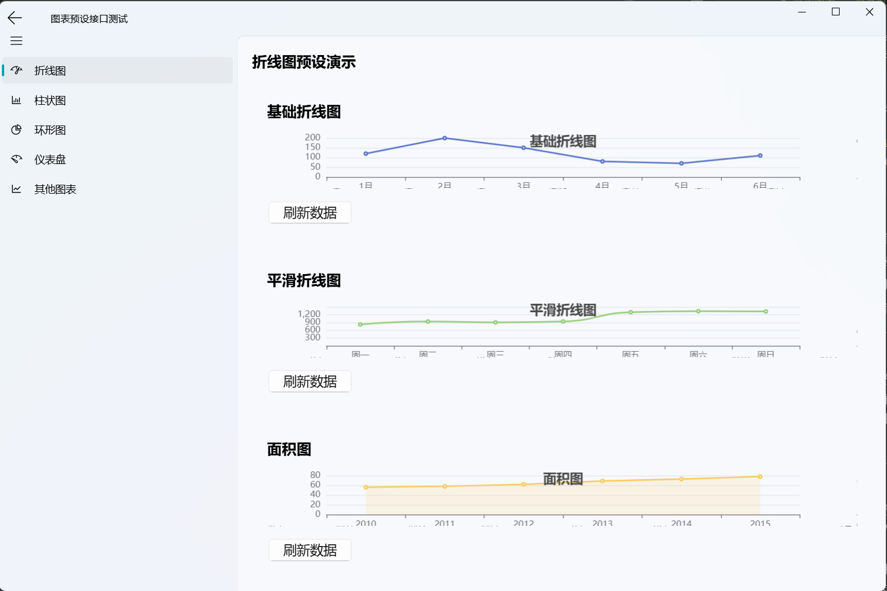

### Sortable Table
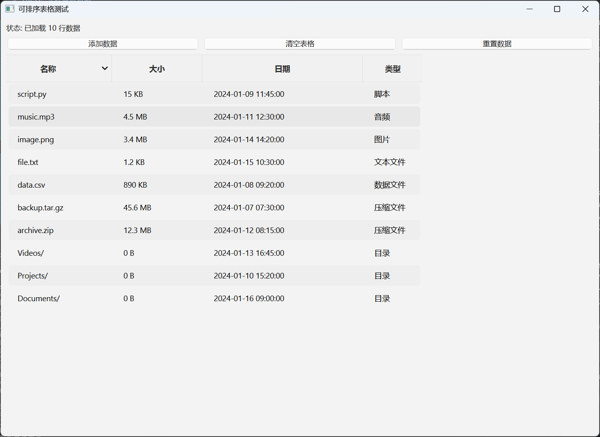

### Acrylic Navigation Window Example
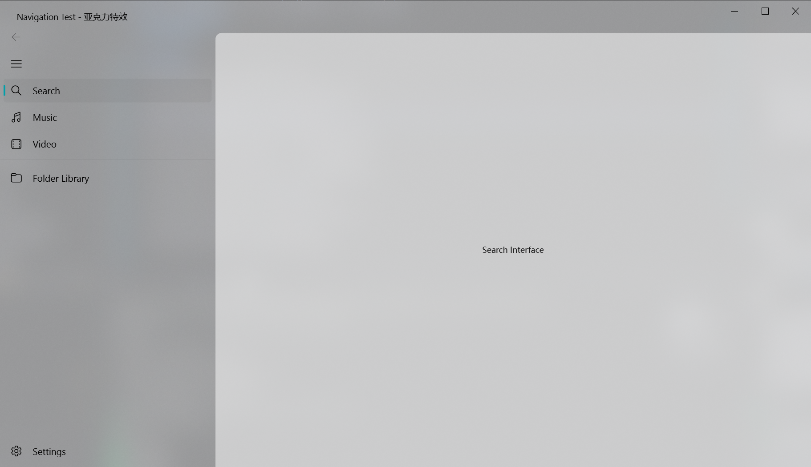

### Full Top Navigation Window Example
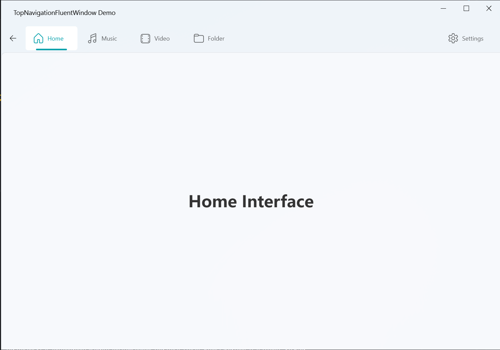

### Command Bar
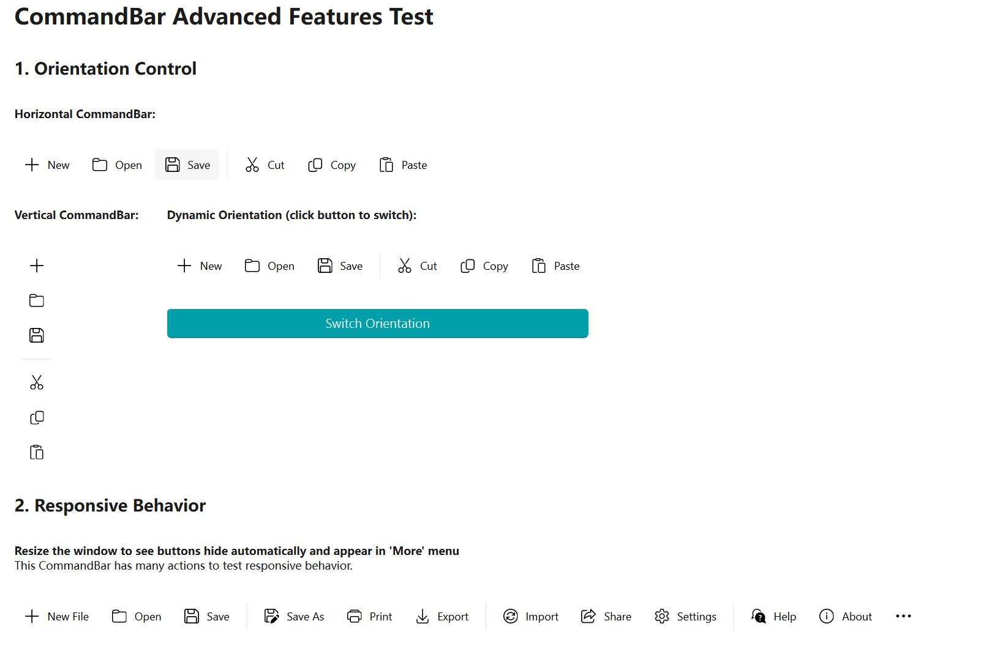
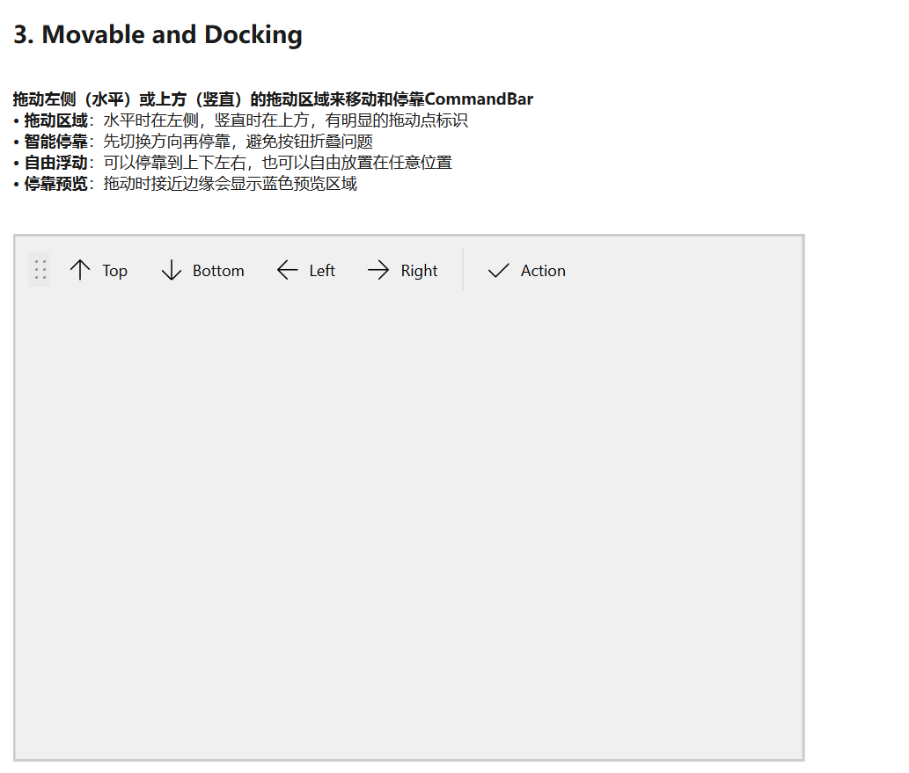

### Menu Bar


### Splitter
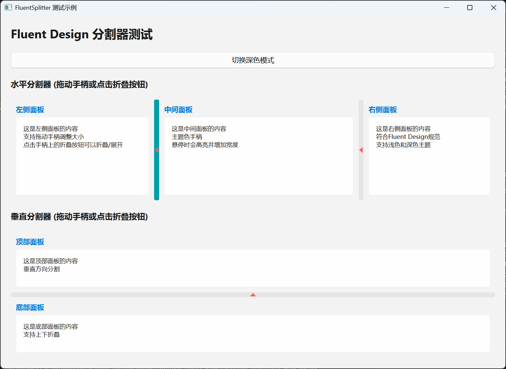

### Tool Panel
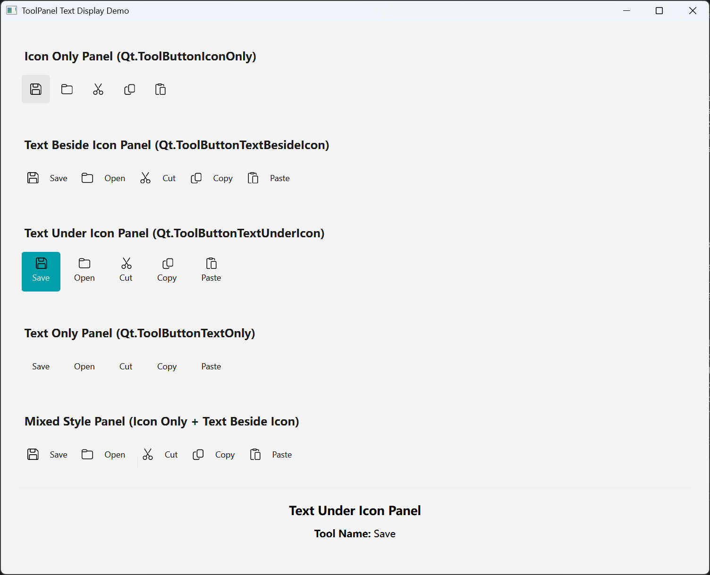

### Label Line Edit
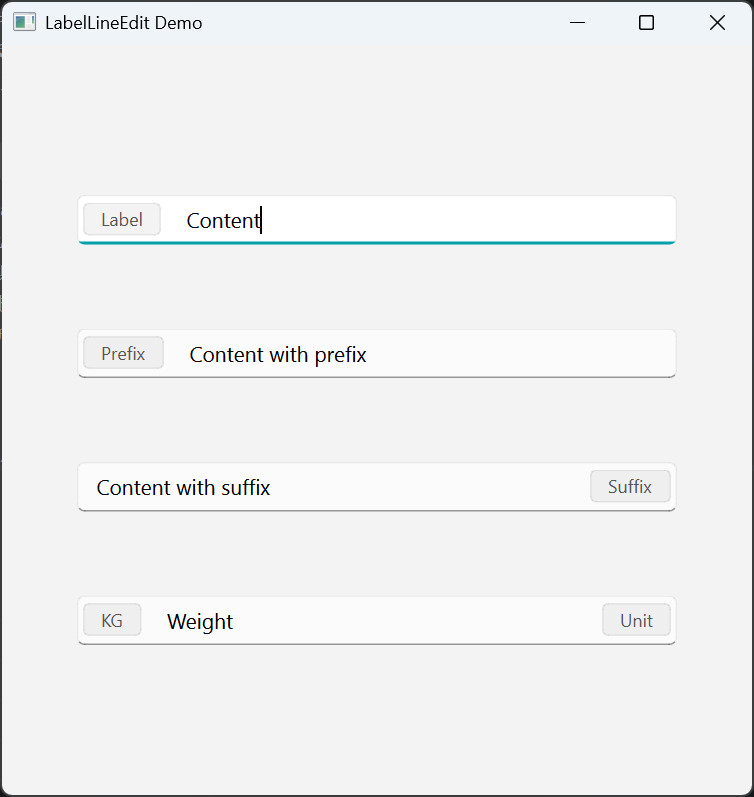

### Tooltip Slider
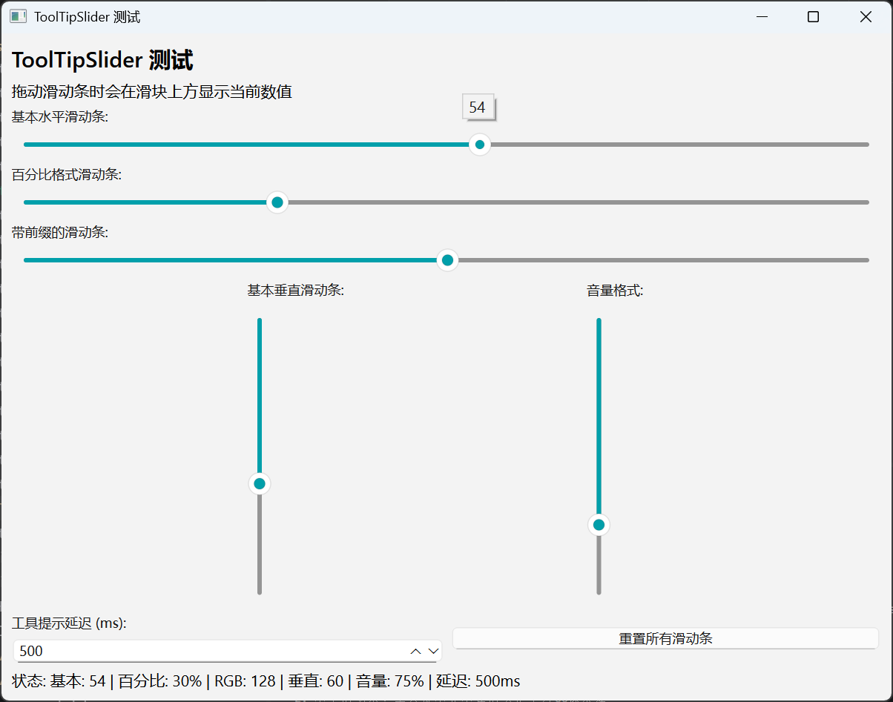

### Color Picker
> Supports color picking, theme color palette, custom color list
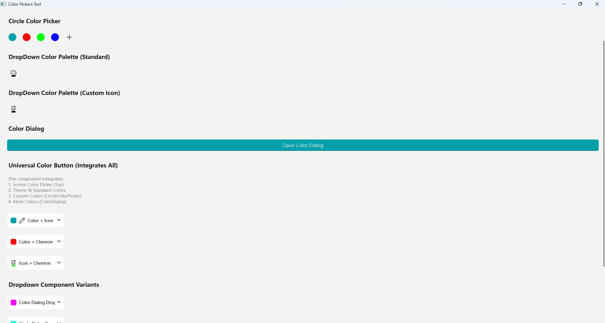

### QML Startup Window & Quick Window


### QML Implementation of FluentWindow
> Dynamic theme switching


## Dependencies & Installation Suggestions
- The Lite version satisfies most component usage scenarios.
- The Full version additionally includes dependencies like vispy, numpy, PyOpenGL, etc., suitable for advanced drawing and charting scenarios.

## Examples & Test Entry Points
- Run gallery example: `examples/gallery/demo.py`
- Component-level examples are located in the `tests/` directory; run the referenced files above as needed.
- For test file descriptions, see `tests/TESTS_SUMMARY.md`.

## Reference
- Official module address and notes: https://github.com/zhiyiYo/PyQt-Fluent-Widgets/tree/PyQt6
