# PySide6-Fluent-Widgets

基于 [PyQt-Fluent-Widgets](https://github.com/zhiyiYo/PyQt-Fluent-Widgets) 的 **PySide6** 分支二次开发版本，面向桌面应用快速构建 Fluent Design 风格界面。

> [!IMPORTANT]
> **仓库已迁移至 GitHub，Gitee 不再维护。**  
> 当前维护地址：https://github.com/liberalchang/PyQt-Fluent-Widgets/tree/PySide6  
> Gitee 旧地址仅作存档：https://gitee.com/liberalchang/pyside6-fluent-widgets

[简体中文](README.md) | [English](README.en.md)

## 特性

- 基于官方 PySide6 分支扩展，版本对齐 `1.11.3-liber.1`
- **Vispy**：2D/3D 绘图、相机与坐标转换，兼容云母（Mica）与最大化窗口
- **ECharts**：动态图表、时序更新、组合图与 View 接口
- **QML Hybrid**：启动窗口、快捷窗口，以及 FluentWindow 的 QML 实现
- 其它二次开发：可排序表格、命令栏、工具面板、分割器、颜色选择器、顶部导航等

## 安装

精简版：

```shell
pip install PySide6-Fluent-Widgets -i https://pypi.org/simple/
```

完整版（含 vispy / numpy / PyOpenGL 等）：

```shell
pip install "PySide6-Fluent-Widgets[full]" -i https://pypi.org/simple/
```

> [!WARNING]
> 不要同时安装 PyQt-Fluent-Widgets、PyQt6-Fluent-Widgets、PySide2-Fluent-Widgets 和 PySide6-Fluent-Widgets，它们的包名均为 `qfluentwidgets`。

## 本地开发

统一使用项目根目录 `.venv`（不再使用 conda）：

```shell
python -m venv .venv
.venv\Scripts\activate
pip install -U pip
pip install -r requirements.txt
pip install -e .
```

## 运行示例

官方示例（gallery）：

```shell
.venv\Scripts\activate
cd examples/gallery
python demo.py
```

二次开发组件示例与说明见 `tests/`，清单：[`tests/TESTS_SUMMARY.md`](tests/TESTS_SUMMARY.md)。

## 文档

```shell
.venv\Scripts\activate
pip install sphinx sphinx-rtd-theme sphinx-markdown-tables recommonmark
build_docs.bat
# 或：python build_docs.py
```

更多说明见 [`docs/README.md`](docs/README.md)。上游用法也可参考 [qfluentwidgets.com](https://qfluentwidgets.com/zh/)。

## 预览

| 模块 | 预览 |
| --- | --- |
| Vispy 2D / 3D | 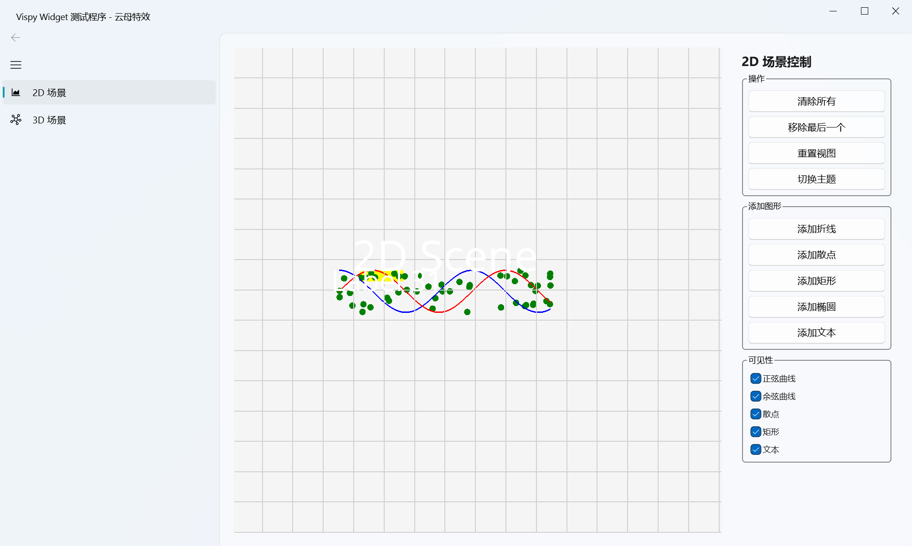 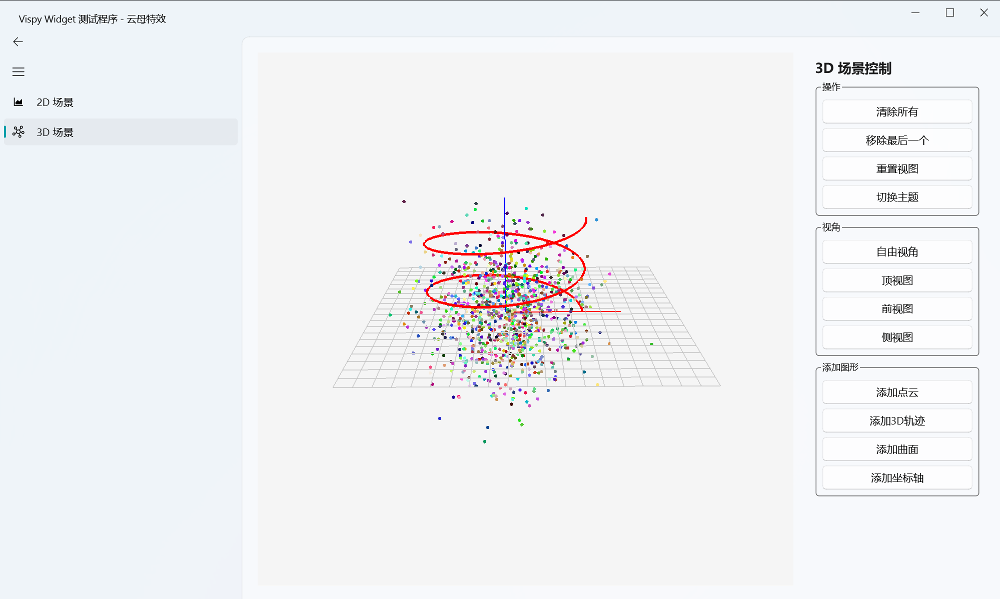 |
| Vispy 交互绘图 | 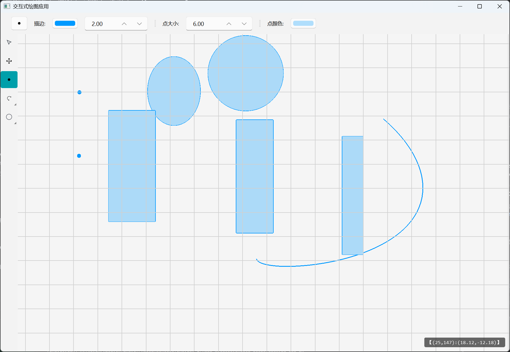 |
| ECharts | 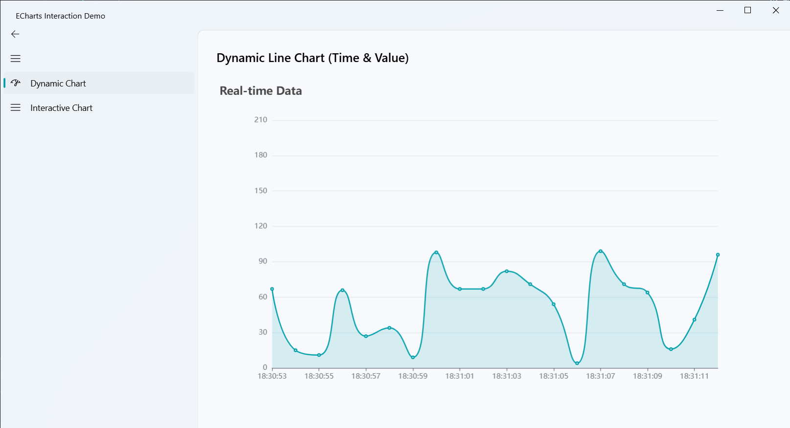 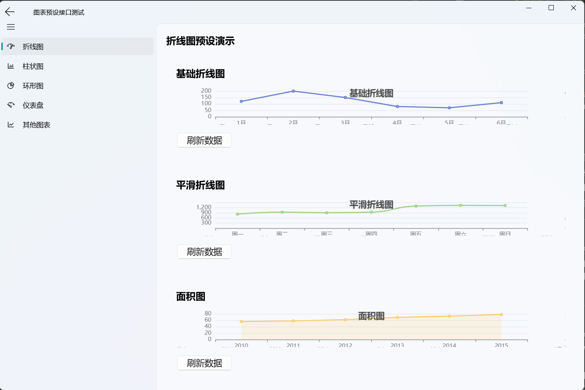 |
| 排序表格 |  |
| 亚克力 / 顶部导航 |   |
| 命令栏 | 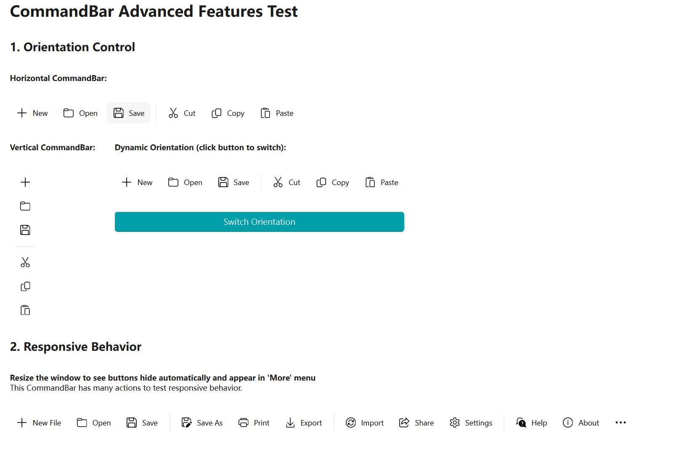 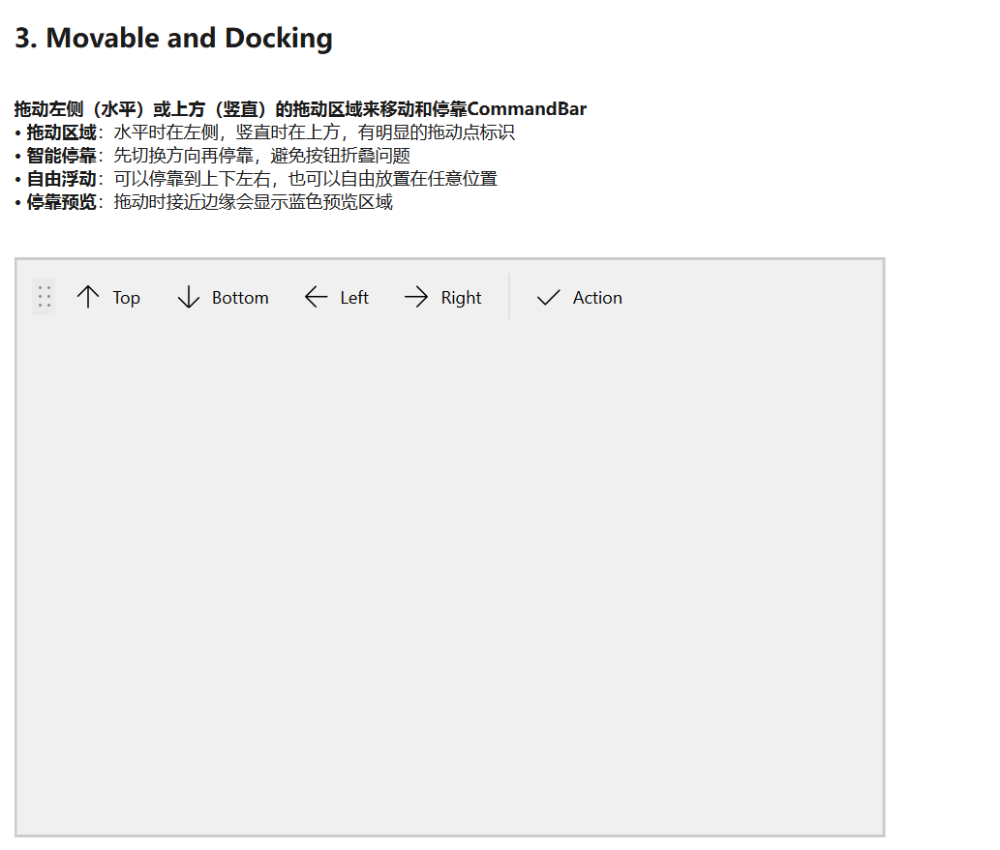 |
| 菜单栏 / 分割器 / 工具面板 | 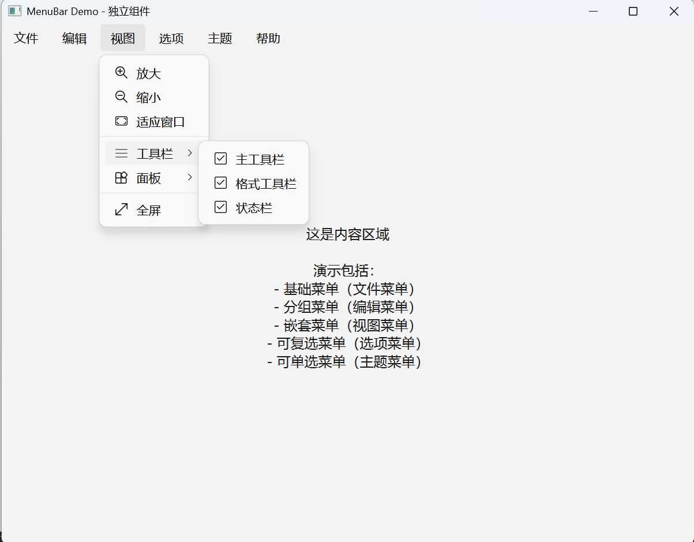 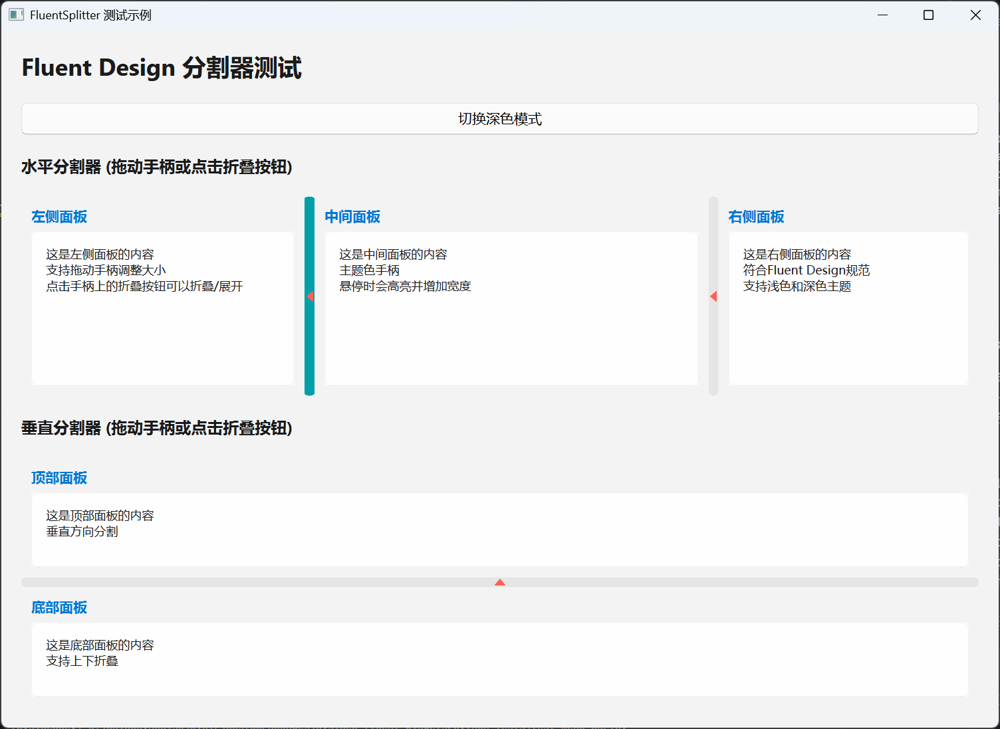 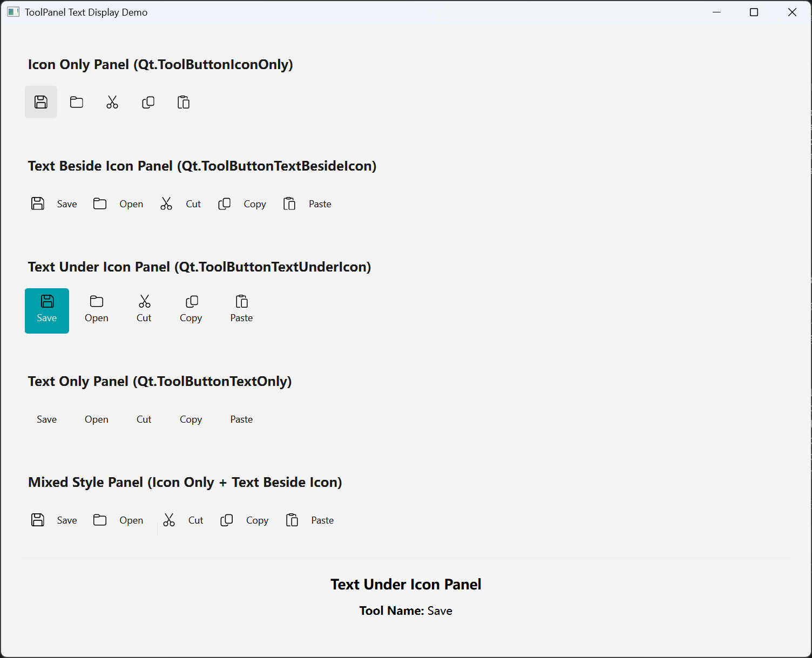 |
| 输入与取色 |   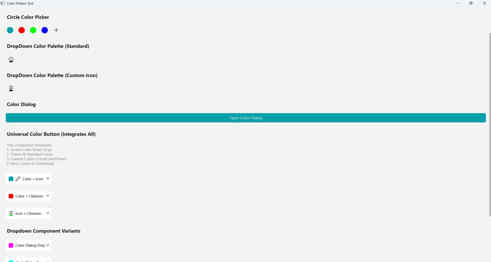 |
| QML 启动 / FluentWindow |  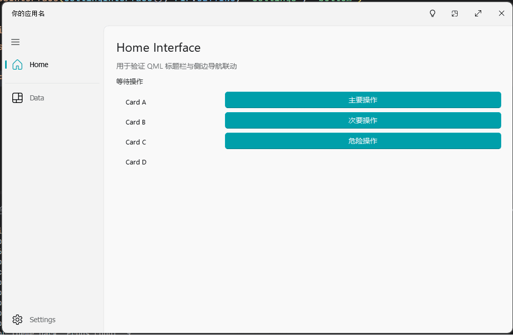 |

## 问题反馈

二次开发相关问题，请先查阅文档与上游说明。若确认为本库 bug，请将以下信息发至 [changxianglong@outlook.com](mailto:changxianglong@outlook.com)：

- 操作系统信息
- 组件库版本（`1.11.3-liber.1` 等）
- 最小复现代码
- 复现步骤

也可在 GitHub 提 Issue：https://github.com/liberalchang/PyQt-Fluent-Widgets/issues

## 仓库

| 用途 | 地址 |
| --- | --- |
| 本项目（维护中） | https://github.com/liberalchang/PyQt-Fluent-Widgets/tree/PySide6 |
| 官方上游 | https://github.com/zhiyiYo/PyQt-Fluent-Widgets/tree/PySide6 |
| Gitee 存档（已停维） | https://gitee.com/liberalchang/pyside6-fluent-widgets |

## 许可证

非商业用途遵循 [GPLv3](LICENSE)；商用授权请参考上游 [QFluentWidgets](https://qfluentwidgets.com/zh/price) 说明。上游版权归 zhiyiYo；本仓库二次开发部分由 liber 维护。
