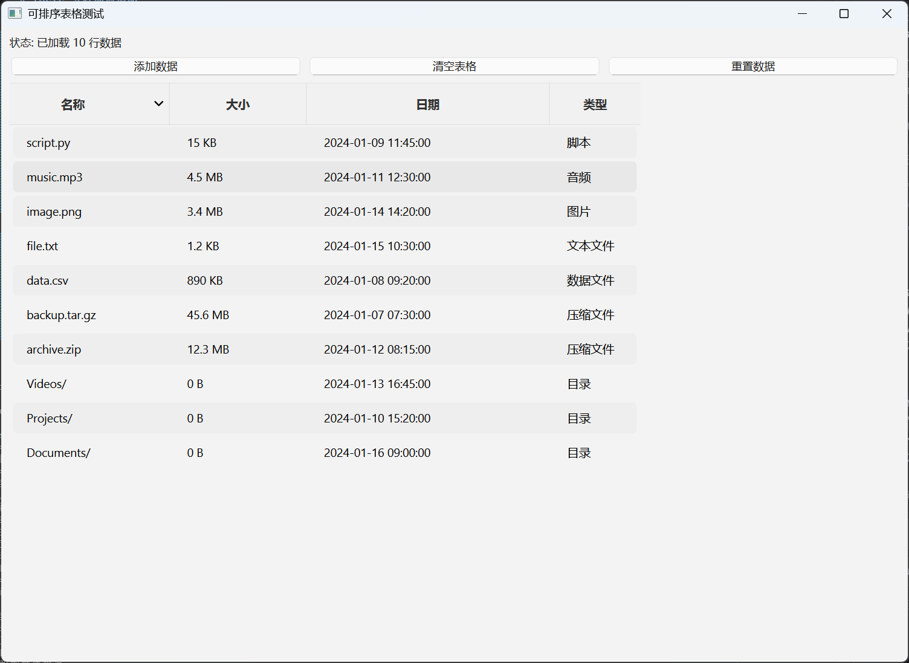
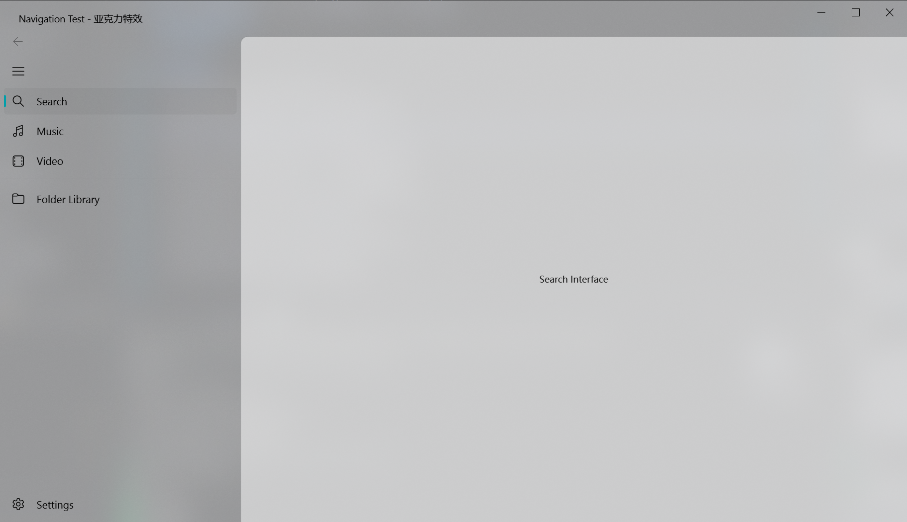
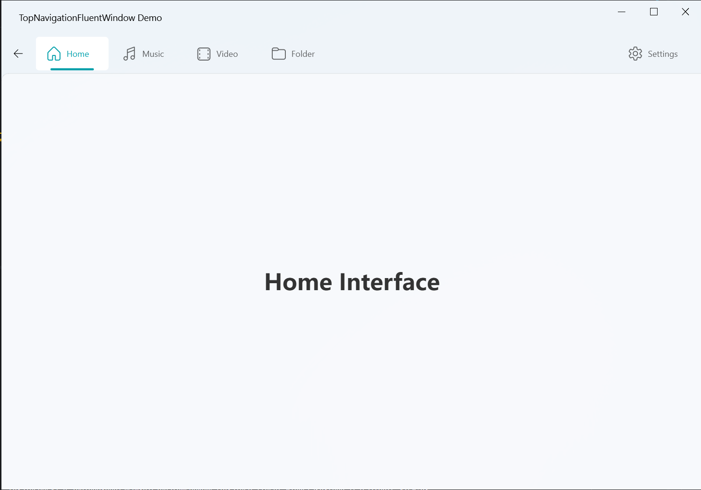
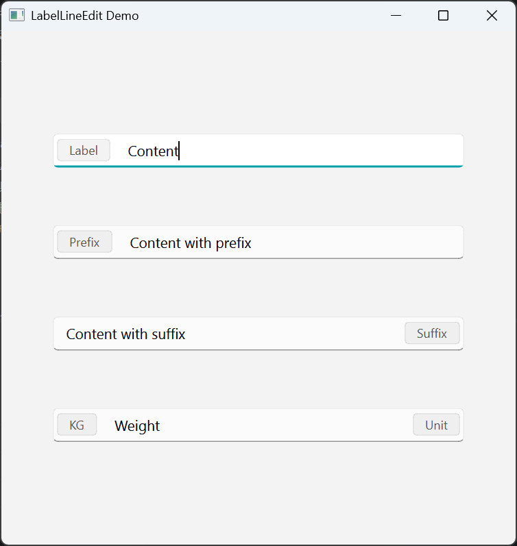
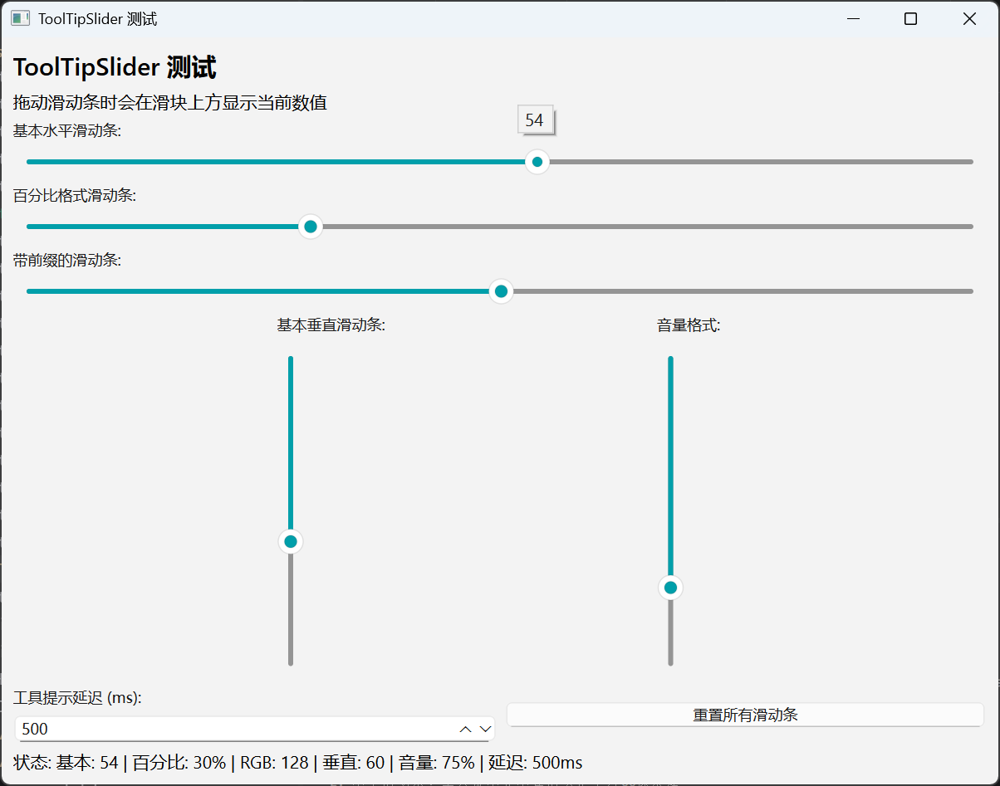

# PySide6-Fluent-Widgets

基于 PyQt-Fluent-Widgets 的 PySide6 分支二次开发版本，新增多个工程化组件与展示能力，面向桌面应用快速构建 Fluent Design 风格界面。

## 特性概览
- 基于官方 PyQt-Fluent-Widgets 的 PySide6 分支扩展
- 新增 vispy 模块实现绘图
- 新增 echarts 实现图表展示
- 新增 qml 实现启动窗口与快捷窗口（FluentWindow 的 qml 实现）

## 安装
精简版安装：
```shell
pip install PySide6-Fluent-Widgets -i https://pypi.org/simple/
```
完整版安装（包含更多可选能力）：
```shell
pip install "PySide6-Fluent-Widgets[full]" -i https://pypi.org/simple/
```

> [!Warning]
> 不要同时安装 PyQt-Fluent-Widgets、PyQt6-Fluent-Widgets、PySide2-Fluent-Widgets 和 PySide6-Fluent-Widgets，因为它们的包名均为 `qfluentwidgets`。

## 文档
构建文档需要安装 `sphinx` 与 `sphinx-rtd-theme` 包：
```shell
pip install sphinx sphinx-rtd-theme
```
构建文档：
```python
python build_docs.py
```
## 运行官方示例
```shell
cd examples/gallery
python demo.py
```

## 说明
本项目在官方 PySide6 分支基础上扩展了以下能力：
- vispy 绘图模块
- echarts 图表模块
- qml 启动窗口与快捷窗口（FluentWindow 的 qml 实现）

## 新增组件详解
- Vispy 绘图：支持 2D/3D 场景渲染、相机控制、坐标转换，兼容云母特效（Mica）与最大化窗口，示例参考 tests/test_vispy_widget.py
- ECharts 图表：支持动态图表、时间序列数据实时更新、组合图，示例参考 tests/echarts_test.py
- QML 启动与快捷窗口：使用 Qt Quick 实现启动窗口与快捷窗口，提供 FluentWindow 的 QML 版本以便快速构建导航窗口

## 功能测试清单（新增组件）
- 绘图与可视化：test_vispy_widget.py、test_drawing_view.py、drawing_app.py、draw_icon_example.py
- 图表：echarts_test.py
- 表格与数据：table_view.py、test_sortable_table.py
- 导航与窗口：test_navigation.py、test_navigation_acrylic.py、test_navigation_opengl.py、test_top_navigation.py、test_top_navigation_simple.py、test_top_navigation_window.py、test_navigation_layout_fix.py、test_navigation_titlebar_fix.py、test_maximize_fix.py、test_simple_maximize.py、test_maximize_mica_effect.py、test_detailed_mica.py、test_pywinstyles.py
- 命令栏与菜单：test_command_bar_orientation.py、test_command_bar_views.py、test_command_bar_advanced.py、test_menu_bar.py
- 面板与布局：test_splitter.py、test_tool_panel.py、test_tool_panel_views.py、test_tool_panel_with_text.py
- 输入与交互：label_line_edit_test.py、test_color_pickers.py、test_tooltip_follow.py、test_tooltip_slider.py、test_new_interaction.py、test_auto_resize_demo.py
- 其他：test_fix_verification.py

## 图片预览

### vispy绘图场景


### vispy鼠标交互绘图场景


### echarts图表动态更新示例


### 排序表格


### 亚克力导航窗口示例


### 完整顶部导航窗口示例


### 命令栏


### 菜单栏


### 分割器


### 工具面板


### 带标签输入框


### 带提示滑动条


### 颜色选择器
> 支持取色、主题色面板、自定义颜色列表


### qml启动窗口与快捷窗口


### FluentWindow 的 qml 实现
> 动态切换主题


## 依赖与安装建议
- 精简版满足大多数组件使用场景
- 完整版额外包含 vispy、numpy、PyOpenGL 等依赖，适合高级绘图与图表场景

## 示例与测试入口
- 运行 gallery 示例：`examples/gallery/demo.py`
- 组件级示例位于 `tests/` 目录，按需运行上述参考文件
- 测试文件说明见 `tests/TESTS_SUMMARY.md`

## 参考来源
- 官方模块地址与说明：https://github.com/zhiyiYo/PyQt-Fluent-Widgets/tree/PyQt6
