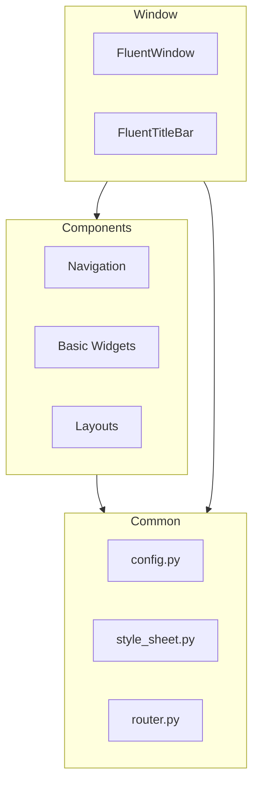
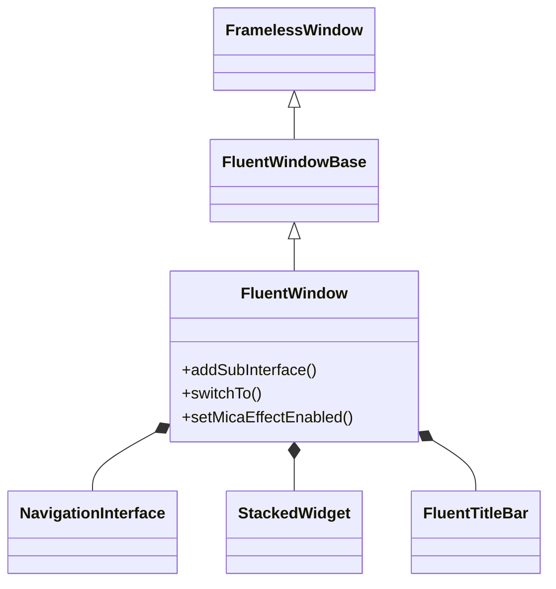

# PySide6-Fluent-Widgets 架构文档

**版本**: 1.10.4
**日期**: 2025-12-29
**状态**: 已验证

## 1. 项目概述

PySide6-Fluent-Widgets 是一个基于 PySide6 的 Fluent Design 风格组件库。该库通过对原生 Qt 控件的封装与自绘，实现了 Windows 11 风格的 UI 交互体验。其核心架构围绕组件化、样式分离和主题响应机制构建，旨在提供一套现代化、可扩展的桌面应用开发框架。

## 2. 核心模块视图

项目源码结构清晰，主要分为以下核心模块：

*   **Common (`qfluentwidgets/common`)**: 基础设施层。包含全局配置 (`config.py`)、样式表管理 (`style_sheet.py`)、动画工具 (`animation.py`) 及图标/字体资源。
*   **Components (`qfluentwidgets/components`)**: 功能组件层。按功能细分为导航 (`navigation`)、布局 (`layout`)、设置 (`settings`)、日期时间 (`date_time`) 及基础控件 (`widgets`)。
*   **Window (`qfluentwidgets/window`)**: 窗口管理层。实现了自定义标题栏和无边框窗口逻辑 (`fluent_window.py`)。
*   **Multimedia (`qfluentwidgets/multimedia`)**: 多媒体扩展。包含媒体播放器相关组件。

## 3. 关键组件架构

### 3.1 FluentWindow (主窗口)

`FluentWindow` 是应用程序的主要入口，继承自 `FluentWindowBase` 和 `FramelessWindow`。它采用复合模式管理导航和内容视图。

*   **源码位置**: `/qfluentwidgets/window/fluent_window.py#L205`
*   **核心职责**:
    *   **布局管理**: 使用 `QHBoxLayout` 容纳 `NavigationInterface` (左侧) 和 `StackedWidget` (右侧内容区)。
    *   **导航联动**: 通过 `addSubInterface` 方法注册子界面，自动创建导航项并绑定点击事件 (`/qfluentwidgets/window/fluent_window.py#L226`)。
    *   **Mica 特效**: 通过 `setMicaEffectEnabled` 控制 Windows 11 Mica 背景特效的开启与关闭 (`/qfluentwidgets/window/fluent_window.py#L122`)。

**类关系图**:

### 3.2 NavigationInterface (导航系统)

导航系统采用分层设计，`NavigationInterface` 作为对外外观类，内部委托 `NavigationPanel` 处理具体的布局和交互。

*   **源码位置**: `/qfluentwidgets/components/navigation/navigation_interface.py#L14`
*   **核心机制**:
    *   **模式切换**: 支持展开 (Expand) 和收起 (Collapse) 模式，通过 `displayModeChanged` 信号通知外部 (`/qfluentwidgets/components/navigation/navigation_interface.py#L17`)。
    *   **事件过滤**: 安装事件过滤器到 `panel` 以拦截和处理特定事件 (`/qfluentwidgets/components/navigation/navigation_interface.py#L40`)。
    *   **动态扩展**: 提供 `addItem` 和 `addWidget` 接口，支持插入标准导航项或自定义 Widget (`/qfluentwidgets/components/navigation/navigation_interface.py#L47`)。

### 3.3 FluentStyleSheet (样式系统)

样式系统是库的视觉核心，通过枚举管理 QSS 资源，并支持动态颜色替换。

*   **源码位置**: `/qfluentwidgets/common/style_sheet.py#L119`
*   **实现逻辑**:
    *   **枚举管理**: `FluentStyleSheet` 枚举类定义了所有组件的样式表路径（如 `BUTTON`, `LINE_EDIT`）。
    *   **模板渲染**: `renderQss` 函数使用 `string.Template` 机制，将 QSS 中的变量（如 `--ThemeColorPrimary`）替换为当前主题色 (`/qfluentwidgets/common/style_sheet.py#L88`)。
    *   **自动应用**: `StyleSheetManager` 监听组件生命周期，确保样式正确加载和卸载 (`/qfluentwidgets/common/style_sheet.py#L14`)。

## 4. 设计模式分析

1.  **单例模式 (Singleton)**:
    *   **应用**: `qconfig` 配置对象和 `styleSheetManager`。
    *   **位置**: `/qfluentwidgets/common/config.py` (引用) 和 `/qfluentwidgets/common/style_sheet.py#L65`。
    *   **作用**: 确保全局配置和样式管理器在应用生命周期内的唯一性。

2.  **观察者模式 (Observer)**:
    *   **应用**: 主题切换响应机制。
    *   **位置**: `/qfluentwidgets/window/fluent_window.py#L48`。
    *   **实现**: `FluentWindow` 连接 `qconfig.themeChangedFinished` 信号，当主题改变时触发 `_onThemeChangedFinished` 刷新 Mica 特效和背景色。

3.  **策略模式 (Strategy)**:
    *   **应用**: 样式表加载策略。
    *   **位置**: `/qfluentwidgets/common/style_sheet.py#L103`。
    *   **实现**: `StyleSheetBase` 定义了 `path` 和 `apply` 接口，具体的枚举成员（如 `FluentStyleSheet.BUTTON`）实现了获取特定组件样式路径的策略。

4.  **代理模式/装饰器 (Proxy/Decorator)**:
    *   **应用**: 复杂控件封装。
    *   **位置**: `/qfluentwidgets/components/widgets/line_edit.py#L85`。
    *   **实现**: `LineEdit` 继承自 `QLineEdit`，但在内部通过布局添加了 `LineEditButton` (如清空按钮)，在保持原有接口的同时扩展了 UI 行为，对用户透明。

## 5. 核心工作流：主题切换

当用户切换主题（Light/Dark）时，系统执行以下流程：

1.  用户调用 `setTheme(Theme.DARK)`。
2.  `qconfig` 更新内部状态，并发送 `themeChanged` 信号。
3.  `StyleSheetManager` 捕获信号，遍历注册的组件，重新读取并渲染 QSS 模板（替换新的颜色变量）。
4.  `FluentWindow` 接收 `themeChangedFinished` 信号 (`/qfluentwidgets/window/fluent_window.py#L105`)。
5.  `FluentWindow` 调用 `windowEffect.setMicaEffect` 更新窗口背景混合模式，确保标题栏和背景色与系统主题一致。

## 6. 版本适配

*   **PySide6 版本**: 兼容 PySide6 6.x 系列。
*   **Qt 版本**: 依赖 Qt 6.x 基础库。
*   **操作系统**: 
    *   Windows 10/11 (完整支持，含 Mica/Acrylic 特效)。
    *   macOS (支持，适配了系统标题栏行为 `/qfluentwidgets/window/fluent_window.py#L45`)。
    *   Linux (基础功能支持，特效可能降级)。

---
*文档生成工具: Trae AI Assistant*
*基于源码路径: d:\BaiduSyncdisk\mydir\CustomPackages\Pyside6-Fluent-Design\package\PyQt-Fluent-Widgets\qfluentwidgets*
