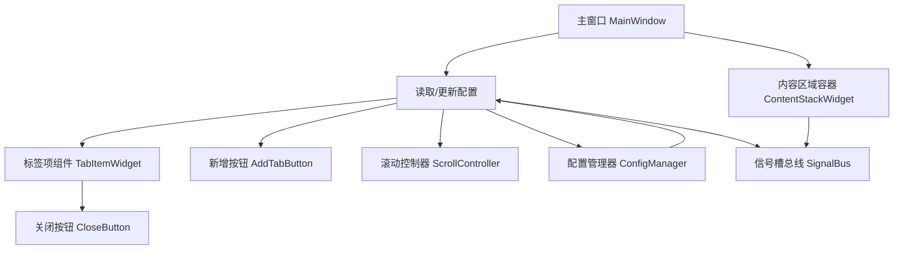

# 圆角标签栏窗口 - PySide6 技术架构与需求文档
## 一、需求文档
### 1. 文档基础信息
| 项⽬ | 内容 |
|--------------|---------------------------------|
| 需求名称 | 基于 PySide6 的圆角标签栏窗口 |
| 目标平台 | Windows/macOS/Linux |
| 技术栈 | Python 3.8+、PySide6 6.5+ |
| 核心诉求 | 实现支持自定义配置的圆角标签栏，满足标签管理、交互、样式定制需求 |

### 2. 功能需求
#### 2.1 核心功能清单
| 功能模块 | 子功能 | 详细描述 |
|----------|--------|----------|
| 标签栏基础展示 | 圆角样式 | 标签栏整体及单个标签项采用圆角矩形设计，圆角半径可配置（默认8px） |
| | 标签结构 | 单个标签包含：图标（可选）+ 文本 + 关闭按钮（×）；标签栏右侧固定显示“新增标签（+）”按钮 |
| | 选中态高亮 | 当前激活标签通过背景色/边框色高亮区分，高亮样式可配置 |
| 标签交互 | 标签切换 | 点击标签项，切换至对应内容区域，同步更新选中态 |
| | 新增标签 | 点击“+”按钮，创建空白新标签，自动切换至新标签页 |
| | 关闭标签 | 点击标签关闭按钮，移除该标签及对应内容；支持“关闭所有标签”“关闭其他标签”右键菜单 |
| | 拖拽排序 | 开启“可拖拽”配置后，支持鼠标拖拽标签调整显示顺序 |
| | 横向滚动 | 开启“可滚动”配置后，标签数量超出显示区域时，支持横向滚动（鼠标滚轮/左右箭头） |
| 配置项控制 | 可拖拽开关 | 全局配置：是否允许标签拖拽排序（默认开启） |
| | 可滚动开关 | 全局配置：是否启用横向滚动（默认开启） |
| | 标签最大宽度 | 全局配置：单个标签最大显示宽度（默认200px），超出宽度文本显示省略号 |
| | 关闭按钮显示模式 | 全局配置：<br>- 始终显示：所有标签关闭按钮永久可见<br>- 悬停时显示：仅鼠标悬浮标签时显示关闭按钮<br>- 从不显示：隐藏所有标签关闭按钮（默认：悬停时显示） |
| 内容区域联动 | 内容同步 | 标签切换时，内容区域同步加载对应标签的业务内容；新标签默认显示空白内容区 |

#### 2.2 非功能需求
| 类型 | 要求 |
|------|------|
| 性能 | 标签数量≤50时，拖拽/切换/滚动操作无卡顿（响应时间≤100ms） |
| 兼容性 | 适配 PySide6 6.5+ 版本，支持 Windows 10+/macOS 12+/Ubuntu 20.04+ |
| 可维护性 | 代码模块化设计，标签栏与内容区解耦，支持业务侧扩展自定义标签内容 |
| 可定制性 | 样式（颜色、圆角、字体）、交互配置（开关、阈值）支持外部传入参数覆盖默认值 |

### 3. 样式需求
| 元素 | 样式要求 |
|------|----------|
| 标签默认态 | 背景色：#F5F5F5；文本色：#333333；边框色：#E0E0E0；圆角：8px |
| 标签选中态 | 背景色：#E3F2FD；文本色：#1976D2；边框色：#1976D2；圆角：8px |
| 标签悬停态 | 背景色：#EEEEEE；无额外边框；圆角：8px |
| 关闭按钮 | 默认尺寸：16×16px；悬停色：#F44336；字体：等线体，12px |
| 新增按钮 | 背景色：#F5F5F5；悬停色：#E0E0E0；图标：“+”号，14px；圆角：8px |
| 滚动箭头 | 仅在标签超出显示区域时显示；尺寸：24×24px；图标：左右箭头；悬停高亮 |

## 二、技术架构设计
### 1. 整体架构（模块化设计）


### 2. 核心模块职责
| 模块 | 类名 | 核心职责 | 关键技术点 |
|------|------|----------|------------|
| 主窗口 | MainWindow | 整合标签栏与内容区，提供全局入口 | 继承 QMainWindow，布局管理 |
| 圆角标签栏 | TabBarWidget | 标签栏整体管理：布局渲染、交互调度、配置生效 | 继承 QWidget，自定义布局（QHBoxLayout），事件重写（鼠标拖拽/滚动） |
| 标签项 | TabItemWidget | 单个标签的渲染、交互（点击/悬停/关闭） | 继承 QFrame，自定义样式（圆角），事件过滤（鼠标悬浮） |
| 滚动控制器 | ScrollController | 处理标签栏横向滚动逻辑，控制滚动箭头显示/隐藏 | 基于 QScrollArea 封装，监听标签尺寸变化 |
| 配置管理器 | ConfigManager | 统一管理所有配置项，提供配置读写/生效接口 | 单例模式，配置参数校验，信号通知配置变更 |
| 内容区域容器 | ContentStackWidget | 管理所有标签对应的内容页，同步标签切换 | 继承 QStackedWidget，动态添加/移除内容页 |
| 信号槽总线 | SignalBus | 标签栏与内容区的解耦通信，定义核心信号（标签切换/新增/关闭） | 自定义信号类，全局信号分发 |

### 3. 核心技术实现方案
#### 3.1 圆角样式实现
- 标签项/按钮采用 `QFrame` 作为载体，通过 `setStyleSheet` 设置圆角：
  ```css
  QFrame#TabItem {
      border-radius: 8px;
      background-color: #F5F5F5;
  }
  QFrame#TabItem:selected {
      background-color: #E3F2FD;
      border: 1px solid #1976D2;
  }
  ```
- 避免 Qt 样式“圆角+背景色”裁剪问题：重写 `paintEvent`，使用 `QPainter` 绘制圆角背景。

#### 3.2 关闭按钮显示模式实现
- 为每个标签项的关闭按钮绑定 `enterEvent`/`leaveEvent`（鼠标进入/离开事件）；
- 配置管理器维护显示模式状态，根据模式动态控制按钮可见性：
  - 始终显示：`close_btn.setVisible(True)`；
  - 悬停时显示：进入事件设为可见，离开事件设为隐藏；
  - 从不显示：`close_btn.setVisible(False)`。

#### 3.3 拖拽排序实现
- 重写 `TabBarWidget` 的 `mousePressEvent`/`mouseMoveEvent`/`mouseReleaseEvent`：
  1. 按下鼠标时，记录选中的标签项和初始位置；
  2. 移动鼠标时，计算拖拽偏移，实时调整标签布局；
  3. 释放鼠标时，更新标签列表顺序，触发重绘。

#### 3.4 横向滚动实现
- 标签栏外层嵌套 `QScrollArea`，隐藏默认滚动条，自定义左右滚动箭头；
- 监听标签栏总宽度与可视区域宽度：超出时显示滚动箭头，点击箭头/滚动鼠标滚轮时调整滚动偏移；
- 滚动逻辑封装在 `ScrollController`，对外提供 `scrollLeft()`/`scrollRight()` 接口。

### 4. 核心类接口设计
#### 4.1 配置管理器（ConfigManager）
```python
class ConfigManager:
    def __init__(self):
        # 默认配置
        self.config = {
            "draggable": True,          # 是否可拖拽
            "scrollable": True,         # 是否可滚动
            "tab_max_width": 200,       # 标签最大宽度
            "close_btn_mode": "hover"   # 关闭按钮模式：always/hover/never
        }

    def set_config(self, key: str, value):
        """设置单个配置项，触发配置变更信号"""
        if key in self.config:
            self.config[key] = value
            self.config_changed.emit(key, value)

    def get_config(self, key: str):
        """获取配置项值"""
        return self.config.get(key)
```

#### 4.2 圆角标签栏（TabBarWidget）
```python
class TabBarWidget(QWidget):
    # 核心信号
    tab_switched = Signal(int)  # 标签切换：参数为标签索引
    tab_added = Signal()        # 标签新增
    tab_closed = Signal(int)    # 标签关闭：参数为标签索引

    def __init__(self, parent=None):
        super().__init__(parent)
        self.config_manager = ConfigManager()  # 配置管理器实例
        self.tab_items = []  # 标签项列表
        self.current_index = 0  # 当前选中标签索引
        self._init_ui()  # 初始化布局
        self._bind_signals()  # 绑定信号槽

    def _init_ui(self):
        """初始化标签栏布局：标签容器 + 新增按钮"""
        pass

    def add_tab(self, title: str, icon: QIcon = None, content_widget: QWidget = None):
        """添加新标签：参数为标题、图标、内容组件"""
        pass

    def remove_tab(self, index: int):
        """移除指定索引的标签"""
        pass

    def switch_tab(self, index: int):
        """切换至指定索引的标签"""
        pass
```

### 5. 扩展与集成方案
- **自定义标签内容**：业务侧可继承 `QWidget` 实现自定义内容组件，通过 `add_tab` 传入标签栏，由 `ContentStackWidget` 管理；
- **样式定制**：提供 `set_style_sheet` 接口，支持业务侧传入自定义 CSS 样式覆盖默认样式；
- **配置持久化**：可扩展配置管理器，支持将配置项保存至本地配置文件（如 JSON/INI），启动时自动加载。

## 三、核心代码示例（关键片段）
### 1. 标签项关闭按钮显示逻辑
```python
class TabItemWidget(QFrame):
    def __init__(self, title: str, close_mode: str = "hover", parent=None):
        super().__init__(parent)
        self.close_mode = close_mode
        # 创建关闭按钮
        self.close_btn = QPushButton("×", self)
        self.close_btn.setObjectName("TabCloseButton")
        # 初始隐藏（根据模式调整）
        if self.close_mode == "always":
            self.close_btn.setVisible(True)
        elif self.close_mode == "hover":
            self.close_btn.setVisible(False)
        else:  # never
            self.close_btn.setVisible(False)

    def enterEvent(self, event: QEvent):
        """鼠标进入事件：悬停时显示关闭按钮"""
        if self.close_mode == "hover":
            self.close_btn.setVisible(True)
        super().enterEvent(event)

    def leaveEvent(self, event: QEvent):
        """鼠标离开事件：隐藏关闭按钮"""
        if self.close_mode == "hover":
            self.close_btn.setVisible(False)
        super().leaveEvent(event)
```

### 2. 标签拖拽排序核心逻辑
```python
class TabBarWidget(QWidget):
    def mousePressEvent(self, event: QMouseEvent):
        if not self.config_manager.get_config("draggable"):
            return super().mousePressEvent(event)
        # 记录按下的标签和初始位置
        self.drag_start_pos = event.pos()
        self.drag_target_tab = self._get_tab_at_pos(event.pos())  # 获取鼠标下的标签
        self.drag_original_index = self.tab_items.index(self.drag_target_tab)

    def mouseMoveEvent(self, event: QMouseEvent):
        if not self.drag_target_tab or not self.config_manager.get_config("draggable"):
            return super().mouseMoveEvent(event)
        # 计算拖拽偏移，判断是否需要调整标签顺序
        delta = event.pos() - self.drag_start_pos
        if delta.manhattanLength() < QApplication.startDragDistance():
            return
        # 实时调整标签布局（简化版）
        target_index = self._get_target_index(event.pos())
        if target_index != self.drag_original_index:
            self._swap_tab_index(self.drag_original_index, target_index)
            self.drag_original_index = target_index

    def _get_tab_at_pos(self, pos: QPoint) -> TabItemWidget:
        """根据鼠标位置获取对应的标签项"""
        for tab in self.tab_items:
            if tab.geometry().contains(pos):
                return tab
        return None

    def _swap_tab_index(self, idx1: int, idx2: int):
        """交换两个标签的索引，更新布局"""
        self.tab_items[idx1], self.tab_items[idx2] = self.tab_items[idx2], self.tab_items[idx1]
        self._refresh_tab_layout()  # 重新渲染标签栏布局
```

## 四、总结
### 关键点回顾
1. **需求核心**：聚焦“圆角样式+可配置交互”，关闭按钮支持3种显示模式，标签支持拖拽/滚动/切换核心交互；
2. **架构设计**：采用模块化解耦（标签栏/内容区/配置管理），通过信号槽实现模块通信，保证扩展性；
3. **技术核心**：基于 PySide6 自定义控件，重写鼠标事件实现拖拽，通过样式表+绘图实现圆角，配置管理器统一管控交互规则；
4. **扩展能力**：支持自定义内容、样式、配置持久化，适配不同业务场景的标签管理需求。

该架构既满足基础的标签栏功能，又通过模块化设计保证了可维护性和可定制性，符合 PySide6 桌面应用的开发最佳实践。